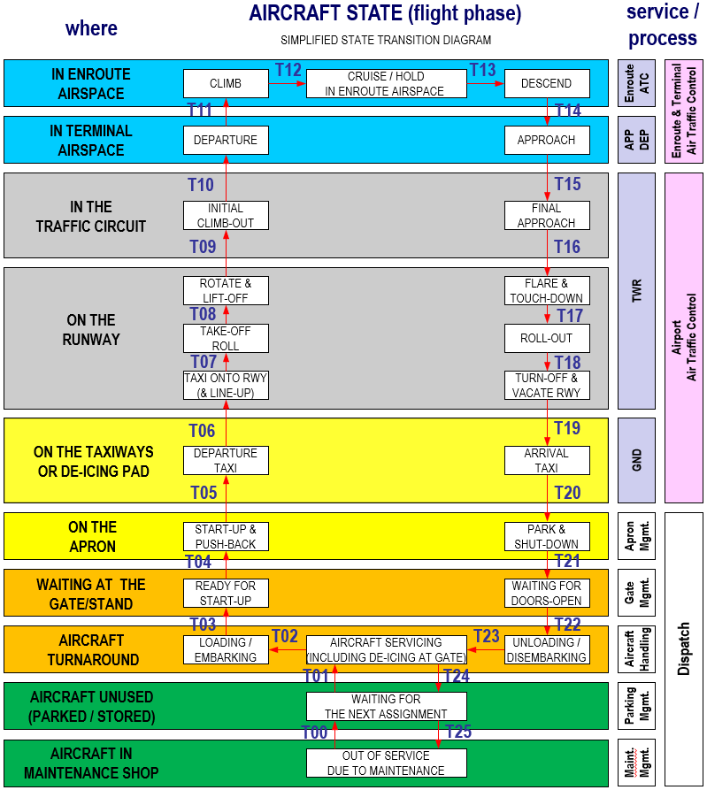

The Open Performance Data Initiative (OPDI) publishes, for each day, a
**flight list** (one row per flight) and a **flight events** file (one row
per event, a moment of a flight such as the take-off, with measurements such
as the distance flown so far). Both are computed from the position reports
of aircraft received by the [OpenSky Network](https://opensky-network.org/).

This section explains how each item is computed. There is one page per item,
or per pair of items that are two ends of one thing (a start and an end).
Every page has the same eight sections:

| Section | What it says |
|---|---|
| In one sentence | What the item is. |
| What it needs | The reports and other items it is computed from. |
| How it is computed | The method, step by step, with every threshold and its unit. |
| Based on | The tool or method it comes from, or "Developed for OPDI". |
| What is published | The event types or columns, and the fields of `info`. |
| Use cases | A few things the item can be used for. |
| Limitations | Its main limits, with a link to [Limitations](../limitations.qmd). |
| Availability and accuracy | How often it exists, and how close it is to the records, with a link to [Data quality](../accuracy/index.qmd). |

[Processing steps](processing-steps.qmd) shows the whole chain from the
OpenSky archive to the published files. Units follow aviation use: altitudes
in feet (ft), distances in nautical miles (NM, 1 NM = 1,852 m), speeds in
knots (kt), vertical rates in feet per minute, times in UTC. Every column and
`info` field is listed in the [Data dictionary](../data/dictionary.qmd).

**Availability and accuracy are kept apart.** Availability says how often an
item exists; accuracy says how close it is to an independent record when it
exists. The column "Compared with" below says which records each item is
compared with, where any exist, and the
[labels at a glance](#labels-at-a-glance) give, for every item, how often
it exists and how close it is to the records.

## The data model {#the-data-model}

OPDI describes a flight with three kinds of information.

**Flight.** One row of the flight list per flight: a track, or each flight
of a track that holds several. It gives the flight's
identifier (`flight_id`), the aircraft address and call sign, the date of
flight, the departure and destination airports, data about the aircraft from
the OpenSky aircraft database, and the main milestones of the flight, such as
the take-off and landing times and runways. A milestone column is empty when
the event behind it was not detected.

**Event.** A moment in a flight, such as the take-off, the top of climb or the
crossing of a flight level. Every event has:

- the flight it belongs to (`flight_id`);
- a position: longitude and latitude in degrees, and an altitude in feet. The
  coordinates use WGS 84, the reference system of GPS. The position is empty
  for the block times;
- a time (`event_time`, in UTC);
- a **type**, for example `top-of-climb` or `xing-fir`;
- a **source**, the origin of the position data (`OSN` for the OpenSky
  Network);
- a **version**, which names the method that produced that event type. A
  method that changes gets a new version, so released data stay reproducible;
- **info**: extra details as JSON text, for example the runway of a take-off
  or the two regions of a crossing from one flight information region (FIR)
  to the next. A FIR is an area of airspace in which one service provider
  gives information to flights.

Some things are not instants but periods, for example a level flight segment
or a holding pattern. They are published as a **pair of events**, one at the
start and one at the end (`level-start` and `level-end`, `holding-start` and
`holding-end`).

**Measurement.** A number attached to an event, published as a column of the
event's row. Two are given for nearly every event: the distance flown since
the start of the track (`distance_flown_nm`, in nautical miles) and the time
passed since the track's `first_seen` (`time_passed_s`, in seconds). Some event families add
their own, for example the time spent in a holding pattern. Because the
measurements are cumulative, subtracting the values of two events of one
flight gives the distance and time between them.

Units follow aviation use: altitudes in feet (ft), distances in nautical miles
(NM, 1 NM = 1,852 m), speeds in knots (kt, nautical miles per hour), vertical
rates in feet per minute and times in UTC.

## Milestones of a flight {#milestones-of-a-flight}

Airports, airlines and air traffic control describe a flight, from one stand
to the next, by a sequence of moments. @fig-flight-phases shows them,
numbered T00 to T25, with the phases of flight between them. The Performance
Review Unit (PRU) made this numbering for this diagram only. It has no
official status, and it is not the numbering of airport collaborative decision
making (A-CDM): the [A-CDM Implementation Manual](../resources.qmd#ref-acdm-manual) numbers its
own 16 milestones 1 to 16, of which OPDI publishes four: landing (6),
in-block (7), off-block (15) and take-off (16). Several moments of the
figure are published by OPDI as event types:

| Number | A-CDM milestone | Moment | OPDI event type | Page |
|---|---|---|---|---|
| T04 | 15 | Off-block: the aircraft leaves its stand | `AOBT` | [Off-block and in-block times](block-times.qmd) |
| T06 | none | The aircraft enters the runway to take off | `line-up` | [Line-up and take-off roll](line-up-take-off-roll.qmd) |
| T07 | none | Start of the take-off roll | `take-off-roll` | [Line-up and take-off roll](line-up-take-off-roll.qmd) |
| T08 | 16 | Take-off: the wheels leave the runway | `ATOT` | [Take-off and landing times](take-off-landing.qmd) |
| T12 | none | Top of climb | `top-of-climb` | [Top of climb and top of descent](tops.qmd) |
| T13 | none | Top of descent | `top-of-descent` | [Top of climb and top of descent](tops.qmd) |
| T16 | none | The aircraft passes over the runway threshold | `xing-runway-threshold` | [Runway threshold crossing](xing-runway-threshold.qmd) |
| T17 | 6 | Touchdown | `ALDT` | [Take-off and landing times](take-off-landing.qmd) |
| T19 | none | The aircraft leaves the runway | `runway-vacated` | [Runway vacated](runway-vacated.qmd) |
| T21 | 7 | In-block: the aircraft stops at its stand | `AIBT` | [Off-block and in-block times](block-times.qmd) |

{#fig-flight-phases width="100%"}

The time between two milestones measures one part of the flight. For
example, the time from `AOBT` to `ATOT` is the taxi-out time, from `ALDT` to
`AIBT` the taxi-in time, and from `ATOT` to `ALDT` the time in the air.
OPDI also publishes moments that have no label in the diagram, such as the
crossing of a flight level, of a distance ring or of a flight information
region, the start and end of a holding pattern, a go-around and a runway
crossing. All event types are listed in the
[Data dictionary](../data/dictionary.qmd#event-types).

## Flight list

| Item | Columns | In one line | Compared with | Limits |
|---|---|---|---|---|
| [Tracks and flight identity](tracks.qmd) | `flight_id`, `icao24`, `flt_id`, `dof` | Which position reports make one flight, and its identifier. | Network Manager flight records | [Tracks](../limitations.qmd#lim-tracks) |
| [Cleaning of position reports](cleaning.qmd) | none (applies to every item) | Repeated, impossible and isolated values are emptied before anything is computed. | Not an item of its own | [Tracks](../limitations.qmd#lim-tracks) |
| [Departure and destination airports](airports.qmd) | `adep`, `ades`, `adep_p`, `ades_p`, `adep_source`, `ades_source` | The airports the flight left from and flew to, from the trajectory alone. | Network Manager flight records | [Airports](../limitations.qmd#lim-airports) |
| [Aircraft details](aircraft.qmd) | `registration`, `model`, `typecode`, `icao_aircraft_class`, `icao_operator` | Looked up by aircraft address in the OpenSky aircraft database. | Network Manager flight records (type) | [Aircraft](../limitations.qmd#lim-aircraft) |
| [First seen and last seen](first-last-seen.qmd) | `first_seen`, `last_seen`, `track_duration_min` | First and last time the aircraft was heard. | Not validated | [First and last seen](../limitations.qmd#lim-first-last-seen) |
| [Milestone columns](flight-list-milestones.qmd) | `atot`, `aldt`, `aobt`, `aibt`, `rwy_dep`, `rwy_dep_bearing_deg`, `rwy_arr`, `rwy_arr_bearing_deg`, `stnd_dep`, `stnd_arr`, `c40_arr`, `c50_arr`, `c60_arr`, `c100_arr`, `c110_arr`, `c120_arr`, `c40_dep`, `c50_dep`, `c60_dep`, `c100_dep`, `c110_dep`, `c120_dep` | The main events of the flight on its row. | Airport operator records | [Milestone columns](../limitations.qmd#lim-flight-list-milestones) |
| [Counting movements](movements.qmd) | `superseded_dep`, `superseded_arr`, `movement_dep`, `movement_arr` | Which rows count as a departure or an arrival. | Not validated | [Milestone columns](../limitations.qmd#lim-flight-list-milestones) |
| Versions | `version`, `release` | The version of the method and the name of the release; no algorithm. See the [Data dictionary](../data/dictionary.qmd#versions). | | |

## Flight events

### Runway

| Event type | In one line | Algorithm | Compared with | Limits |
|---|---|---|---|---|
| `ATOT` | Actual take-off time: the wheels leave the runway. | [Take-off and landing times](take-off-landing.qmd) | Airport operator records | [Take-off and landing](../limitations.qmd#lim-take-off-landing) |
| `ALDT` | Actual landing time: the wheels touch the runway. | [Take-off and landing times](take-off-landing.qmd) | Airport operator records | [Take-off and landing](../limitations.qmd#lim-take-off-landing) |
| `line-up` | A departing aircraft enters the runway. | [Line-up and take-off roll](line-up-take-off-roll.qmd) | Not validated (time to the recorded take-off) | [Runway events](../limitations.qmd#lim-runway) |
| `take-off-roll` | The aircraft starts its take-off run. | [Line-up and take-off roll](line-up-take-off-roll.qmd) | Not validated (time to the recorded take-off) | [Runway events](../limitations.qmd#lim-runway) |
| `xing-runway-threshold` | A landing aircraft passes over the runway threshold. | [Runway threshold crossing](xing-runway-threshold.qmd) | Recorded landing time | [Runway events](../limitations.qmd#lim-runway) |
| `runway-vacated` | An arriving aircraft leaves the runway. | [Runway vacated](runway-vacated.qmd) | Not validated (time from the recorded landing) | [Runway events](../limitations.qmd#lim-runway) |
| `go-around` | An approach given up and flown again. | [Go-around](go-around.qmd) | Not validated | [Runway events](../limitations.qmd#lim-runway) |
| `runway-crossing-entry` | A taxiing aircraft enters a runway to cross it. | [Runway crossings](runway-crossings.qmd) | Not validated | [Runway events](../limitations.qmd#lim-runway) |
| `runway-crossing-vacated` | The same aircraft leaves the runway on the other side. | [Runway crossings](runway-crossings.qmd) | Not validated | [Runway events](../limitations.qmd#lim-runway) |

### Stands and airport surface

| Event type | In one line | Algorithm | Compared with | Limits |
|---|---|---|---|---|
| `AOBT` | Actual off-block time: the aircraft leaves its stand. | [Off-block and in-block times](block-times.qmd) | Airport operator records | [Block times](../limitations.qmd#lim-block-times) |
| `AIBT` | Actual in-block time: the aircraft stops at its stand. | [Off-block and in-block times](block-times.qmd) | Airport operator records | [Block times](../limitations.qmd#lim-block-times) |
| `entry-{element}` | The aircraft enters a taxiway, apron, stand (`parking_position`), threshold area, hangar or de-icing pad (`deicing_pad`). | [Airport surface events](surface-events.qmd) | Stands: recorded block times | [Airport surface](../limitations.qmd#lim-surface) |
| `exit-{element}` | The aircraft leaves that area. | [Airport surface events](surface-events.qmd) | Stands: recorded block times | [Airport surface](../limitations.qmd#lim-surface) |

### Vertical profile

| Event type | In one line | Algorithm | Compared with | Limits |
|---|---|---|---|---|
| `top-of-climb` | End of the climb to cruise. | [Top of climb and top of descent](tops.qmd) | Not validated | [Vertical profile](../limitations.qmd#lim-vertical) |
| `top-of-descent` | Start of the final descent. | [Top of climb and top of descent](tops.qmd) | Not validated | [Vertical profile](../limitations.qmd#lim-vertical) |
| `level-start` | Start of a period of level flight, cruise included. | [Level segments](level-segments.qmd) | Not validated | [Vertical profile](../limitations.qmd#lim-vertical) |
| `level-end` | End of that period. | [Level segments](level-segments.qmd) | Not validated | [Vertical profile](../limitations.qmd#lim-vertical) |
| `level-off-climb-start` | Start of a level-off during the climb. | [Level-offs](level-offs.qmd) | Not validated | [Vertical profile](../limitations.qmd#lim-vertical) |
| `level-off-climb-end` | End of that level-off. | [Level-offs](level-offs.qmd) | Not validated | [Vertical profile](../limitations.qmd#lim-vertical) |
| `level-off-descent-start` | Start of a level-off during the descent. | [Level-offs](level-offs.qmd) | Not validated | [Vertical profile](../limitations.qmd#lim-vertical) |
| `level-off-descent-end` | End of that level-off. | [Level-offs](level-offs.qmd) | Not validated | [Vertical profile](../limitations.qmd#lim-vertical) |
| `xing-fl{level}` | A crossing of flight level 50, 70, 100 or 245 (`xing-fl50` to `xing-fl245`). | [Flight-level crossings](flight-level-crossings.qmd) | Not validated | [Vertical profile](../limitations.qmd#lim-vertical) |

### Airspace and terminal area

| Event type | In one line | Algorithm | Compared with | Limits |
|---|---|---|---|---|
| `xing-{radius}nm` | A crossing of a circle of 40, 50, 60, 100, 110 or 120 NM around the departure or destination airport. | [Distance circle crossings](distance-rings.qmd) | Airport operator records (40 and 100 NM) | [Distance circles](../limitations.qmd#lim-rings) |
| `xing-fir` | A passage from one flight information region to another. | [FIR crossings](fir-crossings.qmd) | Exact region boundaries | [FIR crossings](../limitations.qmd#lim-fir) |
| `holding-start` | First report of a holding pattern. | [Holding patterns](holding.qmd) | Hand-corrected labels | [Holding](../limitations.qmd#lim-holding) |
| `holding-end` | Last report of the holding pattern. | [Holding patterns](holding.qmd) | Hand-corrected labels | [Holding](../limitations.qmd#lim-holding) |
| `pms-leg-entry` | Start of a point merge sequencing leg. | [Point merge](point-merge.qmd) | Not validated | [Point merge](../limitations.qmd#lim-point-merge) |
| `pms-leg-exit` | End of the leg, towards the merge point. | [Point merge](point-merge.qmd) | Not validated | [Point merge](../limitations.qmd#lim-point-merge) |
| `pms-merge-point` | Closest passage of a merge point. | [Point merge](point-merge.qmd) | Not validated | [Point merge](../limitations.qmd#lim-point-merge) |

### Track limits

| Event type | In one line | Algorithm | Compared with | Limits |
|---|---|---|---|---|
| `first_seen` | First time the aircraft of the track was heard. | [First seen and last seen](first-last-seen.qmd) | Not validated | [First and last seen](../limitations.qmd#lim-first-last-seen) |
| `last_seen` | Last time it was heard. | [First seen and last seen](first-last-seen.qmd) | Not validated | [First and last seen](../limitations.qmd#lim-first-last-seen) |

The plausibility checks remove, before
publication, the events that the track clearly contradicts.

## Measurements

| Measurement | In one line | Algorithm | Compared with | Limits |
|---|---|---|---|---|
| `distance_flown_nm` | Distance flown from the start of the track to the event. | [Distance flown](distance-flown.qmd) | Network Manager route length | [Measurements](../limitations.qmd#lim-measurements) |
| `time_passed_s` | Time from `first_seen` to the event. | [Time passed](time-passed.qmd) | Exact by definition | [Measurements](../limitations.qmd#lim-measurements) |
| `holding_duration_s` | Time in a holding pattern (on `holding-end`). | [Holding patterns](holding.qmd) | Not validated | [Holding](../limitations.qmd#lim-holding) |
| `holding_distance_nm` | Distance flown in it. | [Holding patterns](holding.qmd) | Not validated | [Holding](../limitations.qmd#lim-holding) |
| `holding_circuits` | Number of loops flown. | [Holding patterns](holding.qmd) | Not validated | [Holding](../limitations.qmd#lim-holding) |
| `pms_leg_time_s` | Time on a point merge leg (on `pms-leg-exit`). | [Point merge](point-merge.qmd) | Not validated | [Point merge](../limitations.qmd#lim-point-merge) |
| `pms_leg_distance_nm` | Distance flown along the leg. | [Point merge](point-merge.qmd) | Not validated | [Point merge](../limitations.qmd#lim-point-merge) |
| `pms_direct_to_distance_nm` | Distance to the merge point when the aircraft left the leg. | [Point merge](point-merge.qmd) | Not validated | [Point merge](../limitations.qmd#lim-point-merge) |

The availability and accuracy of each item, overall and per airport, with
their labels, are on [Data quality](../accuracy/index.qmd).

## Availability and accuracy at a glance {#labels-at-a-glance}

The labels of every item over the three days measured. Availability:
`high`, `partial` or `low`; accuracy: `good`, `fair`, `limited`,
`too few compared` (mostly missing where the records could check it) or
`no reference`. The rules, the numbers behind every label and the figures
per airport are on [Data quality](../accuracy/index.qmd).



## Start from a question

| Question | Items used | Page |
|---|---|---|
| How long do departures taxi out at an airport? | `AOBT`, `ATOT` | [Off-block and in-block times](block-times.qmd#use-cases) |
| How long do arrivals taxi in? | `ALDT`, `AIBT` | [Off-block and in-block times](block-times.qmd#use-cases) |
| How is each runway used, hour by hour? | `ATOT`, `ALDT` (`info.runway`) | [Take-off and landing times](take-off-landing.qmd#use-cases) |
| How long do arrivals occupy the runway? | `ALDT`, `runway-vacated` | [Runway vacated](runway-vacated.qmd#use-cases) |
| How long do departures wait on the runway? | `line-up`, `ATOT` | [Line-up and take-off roll](line-up-take-off-roll.qmd#use-cases) |
| What is the landing rate over the threshold? | `xing-runway-threshold` | [Runway threshold crossing](xing-runway-threshold.qmd#use-cases) |
| How often are approaches given up? | `go-around`, `ALDT` | [Go-around](go-around.qmd#use-cases) |
| How much time do arrivals spend in the last 40 NM? | `c40_arr`, `aldt` | [Distance circle crossings](distance-rings.qmd#use-cases) |
| How much do arrivals hold before landing? | `holding_duration_s`, `info.context` | [Holding patterns](holding.qmd#use-cases) |
| How much delay is absorbed on point merge legs? | `pms_leg_time_s` | [Point merge](point-merge.qmd#use-cases) |
| How much do flights level off in climb and descent? | level-off events, `info.duration_s` | [Level-offs](level-offs.qmd#use-cases) |
| How long is the climb to cruise? | `ATOT`, `top-of-climb`, `xing-fl100` | [Top of climb and top of descent](tops.qmd#use-cases) |
| How far do flights fly in each region? | `xing-fir`, `distance_flown_nm` | [FIR crossings](fir-crossings.qmd#use-cases) |
| Which taxi routes are used? | `entry-taxiway` | [Airport surface events](surface-events.qmd#use-cases) |
| How many departures and arrivals did an airport have? | `movement_dep`, `movement_arr` | [Counting movements](movements.qmd#use-cases) |
| Which airport pairs are flown, by which aircraft types? | `adep`, `ades`, `typecode` | [Departure and destination airports](airports.qmd#use-cases) |
