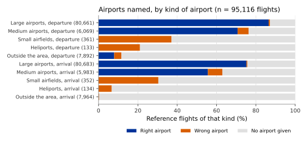

## What it is

Each row of the flight list names the airport the flight left from and the
airport it flew to, as four-letter ICAO codes (for example `EHAM` for
Amsterdam Schiphol). The aircraft does not broadcast these airports. OPDI
works them out from the trajectory alone: no flight plan, no schedule.

The columns are:

| Column | Meaning |
|---|---|
| `adep` | Departure airport (ADEP, aerodrome of departure). |
| `ades` | Destination airport (ADES, aerodrome of destination). |
| `adep_source`, `ades_source` | How the answer was reached: `aerodrome` (an airport was named), `out_of_area` (the track began outside the area covered) or `undetermined` (no answer). |
| `adep_p`, `ades_p` | Other airports that were close, nearest first. |

An empty `adep` or `ades` means that OPDI could not tell. It is not a guess
left out by mistake: the methods are built to give no answer rather than a
doubtful one.

## How it is computed

Departures and arrivals use two different methods, because the evidence is
different at the two ends of a flight. A departing aircraft is usually first
received on or near the runway. An arriving aircraft is often lost by the
receivers before it lands, so its last position can be miles from the
airport.

Both methods choose among **candidate airports**: the large and medium airports
of the OurAirports database (an open list of the world's airports with their
positions, elevations and whether they have scheduled passenger service).
Small airfields and heliports are not candidates. Candidates are found quickly
with a grid of **H3 cells**: H3 is a system that divides the Earth into
hexagons, here at resolution 7, each about 5 km² in area. The distance to each
candidate is then measured exactly, along the great circle, and a candidate
without scheduled service gets 10 NM added to its distance, so that a military
or private field must be clearly nearest to win.

### Departure airport: first position

1. Take the track's first state vector.
2. Find the nearest candidate airport, using the distance with the 10 NM
   addition above.
3. Name it when the first position is at most 30 NM from that airport and the
   aircraft is either on the ground or at most 15,000 ft above the airport's
   elevation.
4. Otherwise, if the first position lies within 30 NM of the edge of the area
   covered, write `OOA` (out of area): the flight entered the area already in
   the air. Otherwise leave `adep` empty.

### Destination airport: altitude trend

1. Take every state vector within 30 NM of a candidate airport and at most
   6,000 ft above that airport's elevation.
2. Smooth the barometric altitude over 5 consecutive samples (about 20 seconds).
3. Let each sample vote: climbing if the smoothed altitude went up since the
   previous sample, descending if it went down.
4. If descending votes outnumber climbing votes, the flight landed at that
   airport.
5. If it landed at several candidates, choose the one closest to the track,
   with the 10 NM addition for airports without scheduled service. When two
   candidates are less than 2 NM apart in that comparison, choose the one the
   aircraft's course points at.

The destination method never writes `OOA`. A track that ends near the edge of
the area may just have lost reception, so that label would too often be wrong.

The pipeline's default coverage is the whole world. The area covered then has
no edge, so `OOA` is not written at all and a flight that entered coverage in
the air has an empty `adep`. In a run limited to the European area, `OOA` is
written as described.

## Reference data

EUROCONTROL **Network Manager** movement data: the departure and arrival
airports of each flight in the European area, for 2025-06-05 to 2025-06-07
(95,116 flights) and, as a second independent sample, 2024-06-05 to
2024-06-07. Reference flights are matched to tracks on the ICAO aircraft
address, the call sign and the date. Where several tracks match, the one that
starts closest to the reference off-block time is used.

## Validation method

The flight list was built from the sample days by the pipeline itself, in the
European area, and each answer compared with the reference. Two measures are
reported for each of `adep` and `ades`:

- **Coverage**: the share of reference flights that get any answer. `OOA`
  counts as an answer.
- **Accuracy**: of the answers given, the share that are right. A right `OOA`
  is a flight whose reference departure airport lies outside the area.

For `OOA`, **precision** (of the flights marked `OOA`, the share that truly
started outside the area) and **recall** (of the flights that truly started
outside, the share marked `OOA`) are reported as well.

The study compared several configurations, including one method for both ends
and a rule that always names the nearest airport. The figures below are for
the default: first position for departures, altitude trend for arrivals. The
study set the altitude limit of the arrival method at flight level 60 (6,000 ft
above sea level, on standard pressure). The default measures it as 6,000 ft
above the airport's elevation instead; a second study measured this setting on
the same 2025 sample (see [Results](#results)).

## Results

| Sample | Departures: coverage | Departures: accuracy | Arrivals: coverage | Arrivals: accuracy |
|---|---|---|---|---|
| June 2025 (95,116 flights) | 80.0% | 98.2% | 68.3% | 98.6% |
| June 2024 (92,799 flights) | 72.7% | 97.8% | 62.1% | 97.3% |

In the 2025 sample, 1,362 departure airports and 923 destination airports were
named wrongly.

By kind of airport (2025 sample):

| Kind of airport | Departures: accuracy | Arrivals: accuracy |
|---|---|---|
| Large airports | 99.2% (80,661 flights) | 99.4% (80,683 flights) |
| Medium airports | 92.6% (6,069 flights) | 88.3% (5,983 flights) |

Flights from or to small airfields and heliports are never named rightly: 0 of
980, because these airports are not candidates.

Out of area: 8.3% of the reference flights started outside the European area.
Of the 704 departures marked `OOA`, 89.2% truly started outside. Of the 7,892
that truly started outside, 8.0% were marked `OOA`; the rest have an empty
`adep`.

With the arrival altitude limit measured above the airport, as in the
default (the study used a limit of 6,100 ft), arrivals reached 68.6% coverage and 98.4% accuracy on the 2025 sample.

## Error distribution

{#fig-by-type}

@fig-by-type shows that the main failure is no answer rather than a wrong
answer. At large airports, wrong answers are rare at both ends. At medium
airports they are more frequent. Small airfields and heliports cannot be named. Flights that
started outside the area mostly get no departure airport, and arrivals from
outside get none by design.

## Headline accuracy

Of the departure airports named, 98.2% are right, with 80.0% of reference
flights given an answer. Of the destination airports named, 98.6% are right,
with 68.3% given an answer (95,116 reference flights, June 2025).

## Limitations

- About one departure in five and one arrival in three get no airport. Counts
  of movements per airport from OPDI are therefore lower bounds, not totals.
- Small airfields and heliports are never named.
- `OOA` is written only for departures, and only in a run limited to the
  European area. With worldwide coverage, a flight that entered coverage in the
  air has an empty `adep`.
- The airports depend on the track. A flight split into two tracks gives two
  rows, one with only `adep` and one with only `ades` (see
  [Track identity](track-identity.qmd)).
- `first_seen` and `last_seen` are the first and last position received, not
  the off-block and on-block times.
- Validated in the European area only, on two samples of three days, both in
  June. The thresholds were chosen on the same samples.
- The arrival altitude limit used today differs slightly from the one in the
  main study (see [Validation method](#validation-method)).
- Positions and elevations of airports come from OurAirports. An error there
  carries over.

## Full study

- [Departure and destination aerodromes in the OPDI flight list](../../papers/adep-ades-detection-v7/index.html):
  the methods, the reference, the parameter choices and the results by
  airport.
- [Detecting departure and destination aerodromes from ADS-B](../../papers/adep-ades-detection-v6.2/index.html):
  the altitude limit measured above the airport instead of above sea level.
