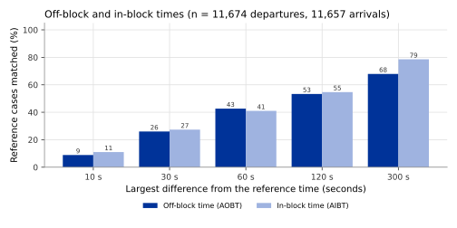
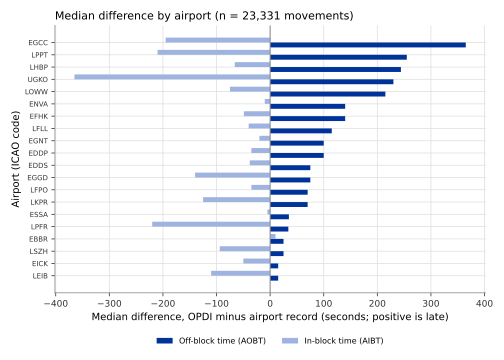

## What it is

At an airport, an aircraft parks at a **stand**: a marked parking position
where passengers board and the aircraft is loaded and refuelled. The **block
times** are the moments it leaves and reaches the stand. The name comes from
the wheel blocks (chocks) placed against the wheels of a parked aircraft.

| Event type | Moment | Standard number |
|---|---|---|
| `AOBT` | **Actual off-block time**: the aircraft starts to move away from its stand, usually pushed back by a tug. | T04 |
| `AIBT` | **Actual in-block time**: the aircraft stops at its stand after landing. | T21 |

The standard numbers are those of airport collaborative decision making
(A-CDM; see [Take-off and landing](takeoff-landing.qmd#what-it-is)). The time
between `AOBT` and the take-off is the **taxi-out time**; the time between the
landing and `AIBT` is the **taxi-in time**.

The `info` field of `AOBT` holds `stand_exit`, the time the track leaves the
stand that belongs to this off-block, with the name of that stand (`stand`)
and its airport (`apt_icao`); that of `AIBT` holds `stand_entry`, `stand` and
`apt_icao` for the stand it reaches. These fields are absent when the stand
passage does not lie in the same part of the track as the block time (see
below).
The events carry the version `events_v0.3.0`.

The flight list repeats the results:

| Column | Meaning |
|---|---|
| `aobt` | Off-block time, from the flight's earliest `AOBT` event. |
| `aibt` | In-block time, from the flight's latest `AIBT` event. |
| `stnd_dep` | The stand the flight left from, with its name in OpenStreetMap (for example `B12`). |
| `stnd_arr` | The stand the flight arrived at, with its name in OpenStreetMap. |

A column is empty when the event behind it was not found, which is common:
these events need reception on the ground.

## How it is computed

The method follows the start-of-movement detection of the open-source
`traffic` library. It works on the cleaned state vectors of each track (see
[Trajectory cleaning](trajectory-cleaning.qmd)), one every 5 seconds.

1. **Stands.** The stands of each airport come from OpenStreetMap, the open
   map of the world, where they are mapped as `parking_position` features.
   The visits of a track to a stand are the `entry-parking_position` and
   `exit-parking_position` events (see
   [Airport surface events](surface-events.qmd)).
2. **Reports that may be on the ground.** Only state vectors that may be on
   the ground are used to find movement: those flagged on the ground by the
   aircraft, those without an altitude, and those at most 2,000 ft above the
   airport of their leg (the nearer of the departure and the destination
   airport). State vectors in flight are left out, so the flight itself is
   never read as movement on the ground. A state vector without a position
   that carries an altitude and is not flagged on the ground counts neither
   as ground nor as flight.
3. **Ground speed.** Take the ground speed of each state vector. Where it is
   missing, compute it from the distance between consecutive positions divided
   by the time between them, and take the median over three consecutive
   samples to smooth out jumps.
4. **Moving.** A state vector is moving when its ground speed is above 2 kt.
   Consecutive moving state vectors form a run; a silence of more than 300 s
   ends it. A run counts as real movement when it lasts at least 30 s; shorter
   runs are noise in the speed.
5. **Parts of the track.** The track is in flight where state vectors that are
   not on the ground follow each other for at least 30 s; a shorter stretch
   of them is an altitude error, not a flight. The take-off times (`ATOT`) and
   landing times (`ALDT`) of the track cut it into parts, and each block time
   is read from the part on the correct side of its take-off or landing:
   - from the start of the track to a take-off: `AOBT` is the start of the
     first real movement in that part;
   - from a landing to the end of the track: `AIBT` is the end of the last
     real movement in that part;
   - from a landing to a take-off (the aircraft landed, stood at its stand and
     left again): when a stand passage lies in that part, the longest stop
     between two movements in it is the stop at the stand. `AIBT` is the end
     of the movement before it and `AOBT` the start of the movement after it.
     Without a stand passage in the part, the stop is a wait, for example at
     a holding point between two circuits, and gives no block time.

   Where the track has no take-off time, or starts with a landing, `AOBT` is
   read from the ground part at the start of the track, up to its first state
   vector in flight. Where it has no landing time, or ends with a take-off,
   `AIBT` is read from the ground part at its end, after its last state vector
   in flight. A take-off or landing that was not found therefore does not
   cost the block time next to it.
6. **From or to a standstill.** An `AOBT` is the start of a movement from a
   standstill: the state vector where the movement starts is at most 30 kt
   fast, or is flagged on the ground. An `AIBT` is the end of a movement in
   the same way. The speed is the lower of the reported ground speed and the
   speed computed from the positions, because the reported value is sometimes
   stale on the ground. When a track starts while the aircraft is already
   faster than 30 kt (first received on the take-off roll, in the climb or on
   final approach), the moment it left the stand was not seen and no `AOBT`
   is given, flagged on the ground or not; when the track ends while the
   aircraft is still faster than that, no `AIBT` is given. Only the first
   movement of a part is read for an `AOBT` and the last for an `AIBT`.
7. **Stand passage.** An `AOBT` needs at least one `exit-parking_position`
   event in the track, and an `AIBT` at least one `entry-parking_position`
   event. Without it, a track first received while the aircraft was already
   taxiing would report the start of its taxi as an off-block, which would
   look like a very short taxi rather than a missing value. When the stand
   passage lies in the same part of the track, the event names that stand
   and its airport.

The [plausibility checks](plausibility-checks.qmd) then leave out an `AOBT`
or `AIBT` that the track contradicts: one placed while the aircraft is more
than 1,500 ft above the airport, faster than 80 kt and not reported on the
ground; an `AOBT` at or after the take-off of its own leg; and an `AIBT` at
or before the landing of its own leg. Each block time carries that take-off
or landing in its `info` field (`take_off` or `landing`, with the method that
found it in `take_off_method` or `landing_method`).

The events carry no position, no altitude and no distance or time
measurements: those fields are empty.

The flight list takes `aobt` from the earliest `AOBT` of the flight and
`aibt` from the latest `AIBT`. `stnd_dep` is the stand named by that `AOBT`
when it lies at the departure airport; otherwise it is the OpenStreetMap name
of the stand of the flight's earliest `exit-parking_position` at its departure
airport. `stnd_arr` is the stand named by the `AIBT` at the destination
airport, otherwise that of the latest `entry-parking_position` there.

## Reference data

**Airport operator records** (APDF) for three days, 5 to 7 June 2026, at the
20 airports with the best ADS-B reception, as described for the
[take-off and landing times](takeoff-landing.qmd#reference-data). For each
movement the records give the actual off-block and in-block times. They also
give the stand, but the stand has not been compared.

## Validation method

The same method as for the
[take-off and landing times](takeoff-landing.qmd#validation-method): each
reference movement is matched to the OPDI flight with the same aircraft
address, call sign and day; the nearest `AOBT` (or `AIBT`) event is taken;
the difference is OPDI time minus reference time, positive when OPDI is late.
Coverage, median difference, median absolute difference, the 90th percentile
of the absolute difference and the shares within 10 s to 300 s are counted
over all reference movements. The study also computed the median difference
for each airport.

## Results

These figures come from the flight-events study, which took the block times
from the first and last movement of the whole track rather than from the
ground part of each leg described above. Figures for one day with the method
as described, against the records of about ninety European airports, are on
[Plausibility checks](plausibility-checks.qmd#results).

The study covers 20 airports, 11,674 reference departures and 11,657
reference arrivals.

| | Off-block time (`AOBT`) | In-block time (`AIBT`) |
|---|---:|---:|
| Coverage | 90.13% | 87.59% |
| Median difference | +62.0 s | −65.0 s |
| Median absolute difference | 70.0 s | 70.0 s |
| 90th percentile of absolute difference | 440.0 s | 305.0 s |
| Within 10 s | 8.89% | 11.04% |
| Within 30 s | 26.02% | 27.35% |
| Within 60 s | 42.66% | 41.02% |
| Within 120 s | 53.34% | 54.68% |
| Within 300 s | 67.92% | 78.57% |

The shift has the same direction almost everywhere. `AOBT` is later than the
airport's record at all 20 airports, with a median difference
between +15.0 s and +365.0 s depending on the airport. `AIBT` is earlier than
the record at 19 of the 20 airports, with a median difference between
−365.0 s and +10.0 s.

The stand columns `stnd_dep` and `stnd_arr` are not validated.

## Error distribution

{#fig-within}

{#fig-by-airport}

@fig-within shows that the block times are much less precise than the take-off
and landing times: fewer than half are within a minute of the record.
@fig-by-airport shows that the error is mostly a shift, not scatter: OPDI's
off-block is late and its in-block early at nearly every airport. The size of
the shift varies a lot between airports, from about 15 s at Ibiza (LEIB)
and Cork (EICK) to several minutes at Manchester (EGCC). The cause of the
shift has not been established.

## Headline accuracy

`AOBT`: 42.66% of 11,674 reference departures at 20 airports have an
off-block time within 60 s of the airport's record (67.92% within 300 s);
median difference +62.0 s. `AIBT`: 41.02% of 11,657 reference arrivals
within 60 s (78.57% within 300 s); median difference −65.0 s.

## Limitations

- The times carry a shift of about a minute: off-block late, in-block early.
  Taxi-out times (take-off minus `AOBT`) and taxi-in times (`AIBT` minus
  landing) computed from OPDI are therefore too short by a similar amount.
  Use the block times for counting and for stand use at a resolution of
  minutes, not for differences of seconds.
- The size of the shift depends on the airport. Do not compare taxi times
  between airports without allowing for it.
- The study airports are the 20 with the best reception. Elsewhere, an
  aircraft at its stand is often not received at all, and coverage is much
  lower.
- The events need stands mapped in OpenStreetMap at the airport. Where stands
  are missing or misplaced there, no block time is found.
- The accuracy figures on this page were measured with block times taken
  from the whole track. Figures with the ground part of each leg exist for one
  day only (see [Plausibility checks](plausibility-checks.qmd#results)).
- A block time needs a stand passage somewhere in the track, not necessarily
  in its own part. When the passage lies elsewhere, the time is kept but
  names no stand.
- The flight list's `aobt` and `aibt` are not checked against the departure or
  destination airport, unlike the stand and runway columns.
- The events have no position, no altitude and no distance or time
  measurements.
- The stand name is the `ref` tag of OpenStreetMap. It can differ from the
  name the airport uses, and is empty where OpenStreetMap has none. The stand
  columns have not been compared with the airport records.
- The stand named is the stand area the track leaves first at or after the
  off-block time, or enters last at or before the in-block time, in the same
  part of the track. If the track starts while the aircraft is already
  taxiing, or ends before it parks, this can be a stand it only passed over.

## Full study

- [Flight events from ADS-B](../../papers/flight-events-v4/index.html),
  chapter "Off-block and on-block" and Annex A (accuracy by airport). The study
  publishes these events under the names `off-block` and `on-block`; the method
  is the same.
