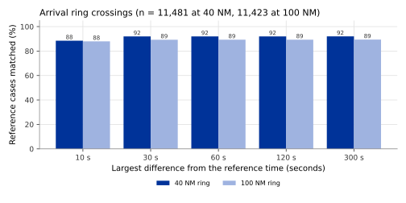

## What it is

A **distance ring** is a circle of fixed radius around an airport. OPDI
publishes an event each time a flight crosses a ring of 40, 50, 60, 100, 110
or 120 NM around its own departure or destination airport. The event types
are `xing-40nm`, `xing-50nm`, `xing-60nm`, `xing-100nm`, `xing-110nm` and
`xing-120nm`.

Rings are used to measure the last part of an arrival and the first part of a
departure. The time an arrival takes from the 40 NM ring to landing, compared
with an unimpeded time, is ICAO's indicator of additional time in the
terminal area (KPI08). EUROCONTROL also uses a 100 NM ring, for airports where
aircraft wait further out. The other radii give a coarse picture of the climb
and the descent.

Each event carries a position, the altitude of the crossing, the distance
flown and the time passed. Its `info` field holds:

| Field | Meaning |
|---|---|
| `apt_icao` | The airport the ring is drawn around. |
| `direction` | `inbound` when the flight moves towards the airport, `outbound` when it moves away. |
| `crossing_seq` | The number of the crossing of this ring on the flight, 1 for the first. |
| `bearing` | Direction of the crossing point seen from the airport, in degrees clockwise from true north. |
| `flight_level` | The aircraft's flight level at the crossing (barometric altitude in hundreds of feet). |
| `bracket_s` | Time between the two state vectors the crossing was placed between, in seconds. |

The events carry the version `events_v0.3.0`.

The flight list has one column per ring and direction, in UTC:

| Columns | Meaning |
|---|---|
| `c40_arr`, `c50_arr`, `c60_arr`, `c100_arr`, `c110_arr`, `c120_arr` | Time of the **last** inbound crossing of that ring around the destination airport. |
| `c40_dep`, `c50_dep`, `c60_dep`, `c100_dep`, `c110_dep`, `c120_dep` | Time of the **first** outbound crossing of that ring around the departure airport. |

A column is empty when the crossing was not found.

## How it is computed

The method works on the cleaned state vectors of each track (see
[Trajectory cleaning](trajectory-cleaning.qmd)), one every 5 seconds.

1. Take the departure and destination airports of the flight from the flight
   list, and their positions from OurAirports. Rings are drawn only around
   these two airports, not around airports the flight passes on the way.
2. For each state vector, compute the great-circle distance to each of the two
   airports.
3. **Dead band.** A track that runs along a ring would cross it many times. To
   avoid this, a band of 1 NM is used on each side of the ring. The aircraft
   counts as outside the 40 NM ring only once it is more than 41 NM away, and
   as inside only once it is less than 39 NM away. Inside the band it keeps the
   side it was last on. A crossing is the moment the side changes.
4. **Interpolation.** The time, position, flight level, distance flown and
   time passed of the crossing are interpolated in a straight line between the
   two state vectors on either side of the ring itself.
5. The bearing is computed from the airport to the interpolated position.
6. A crossing between two state vectors that are more than 30 minutes apart (a
   reception gap kept inside a track; see [Track identity](track-identity.qmd))
   is not reported: its time and position would be guesses.
7. Every crossing is kept and numbered in time order.

The same crossing method is used for the flight-level crossings (see
[Vertical events](vertical-events.qmd)).

The flight list takes, for `cNN_arr`, the last inbound crossing of the ring
around the destination airport and, for `cNN_dep`, the first outbound crossing
of the ring around the departure airport.

## Reference data

**Airport operator records** (APDF), described on
[Take-off and landing](takeoff-landing.qmd#reference-data). For each arrival,
the records also give the time and position at which the flight crossed the
40 NM and the 100 NM rings around the airport, to the second. Unlike most
times in these records, they are not rounded to the minute.

The comparison used three days, 5 to 7 June 2026, at the same 20 airports with
the best ADS-B reception as for the take-off and landing times. Departure
crossings and the rings of 50, 60, 110 and 120 NM are not in the records.

## Validation method

1. For each reference arrival, find the OPDI flight with the same aircraft
   address and call sign on the same day.
2. Take that flight's events of the same ring (`xing-40nm` or `xing-100nm`)
   and use the one nearest in time to the reference crossing.
3. Compute the time difference, OPDI minus reference, and the great-circle
   distance between the two crossing positions.
4. Report coverage (the share of reference arrivals for which OPDI has a
   crossing of that ring), the median difference, the median absolute
   difference, the 90th percentile of the absolute difference, the shares
   within 10 s to 300 s (counted over all reference arrivals), and the median
   and 90th percentile of the position difference.

The comparison uses the event nearest in time, not the flight list column.
The column takes the last inbound crossing at the destination; for an arrival
that crosses the ring only once, the two are the same.

## Results

| | 40 NM ring | 100 NM ring |
|---|---:|---:|
| Reference arrivals | 11,481 | 11,423 |
| Coverage | 96.56% | 94.96% |
| Median difference | +0.2 s | +0.1 s |
| Median absolute difference | 2.0 s | 1.9 s |
| 90th percentile of absolute difference | 7.3 s | 7.3 s |
| Within 10 s | 88.48% | 87.92% |
| Within 60 s | 91.98% | 89.28% |
| Within 300 s | 92.02% | 89.38% |
| Median position difference | 0.10 NM | 0.17 NM |
| 90th percentile of position difference | 0.60 NM | 0.82 NM |

For 4.54% of reference arrivals at 40 NM and 5.58% at 100 NM, OPDI has a
crossing of the ring but the nearest one is more than 300 s away from the
reference. The study did not analyse these cases.

Departure crossings and the other four rings are not validated.

## Error distribution

{#fig-within}

@fig-within shows two groups of arrivals. For most, the OPDI crossing is
within a few seconds of the reference. For a small group, the crossing found
is far from the reference, and widening the tolerance from 10 s to 300 s
hardly adds any. Times between these two groups are rare.

## Headline accuracy

40 NM ring: for 88.48% of 11,481 reference arrivals at the study airports, OPDI's
crossing is within 10 s of the airport records, with a median position
difference of 0.10 NM. 100 NM ring: 87.92% of 11,423 reference arrivals
within 10 s.

## Limitations

- Only arrival crossings of the 40 NM and 100 NM rings were compared, at the 20
  airports with the best reception. Departure crossings and the other four
  rings use the same method but are not validated.
- Rings are drawn only around the departure and destination airports in the
  flight list. If the flight list names the wrong airport, the crossings are
  around the wrong airport; if it names none, there are none.
- A track that starts inside a ring (aircraft first received after the
  crossing) has no outbound crossing of that ring, and a track that ends before
  the ring has no inbound one.
- An aircraft that flies along a ring, within 1 NM of it, is not counted as
  crossing it until it leaves the band on the other side.
- Where the two state vectors around a crossing are far apart (see
  `bracket_s`), the interpolated time and position are less precise. Crossings
  across a gap of more than 30 minutes are not reported.
- About one arrival in twenty has a crossing far from the reference. Check
  `crossing_seq` and `direction` when a flight has several crossings of the
  same ring.
- The comparison of the distance flown inside the 40 NM ring with the
  airports' records has not been made (see
  [Measurements](measurements.qmd#reference-data)).

## Full study

- [Flight events from ADS-B](../../papers/flight-events-v4/index.html),
  chapters "Ring crossings" and "Flight-level crossings" (the crossing method).
