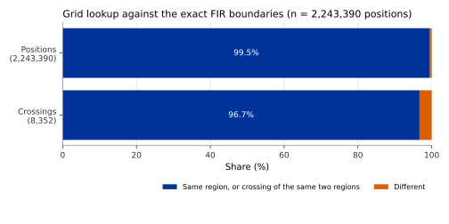

## What it is

The airspace of the world is divided into **flight information regions
(FIRs)**. Each FIR is an area in which one air navigation service provider
gives flight information and alerting services. In much of the world the
airspace above a certain level is a separate **upper information region
(UIR)**, often with the same four-letter prefix (for example `EGTTFIR` below
and `EGTTUIR` above, over London). Counting the flights and the distance flown
in each region is a basic measure of the work of each provider.

OPDI publishes one `xing-fir` event each time a flight passes from one region
to another. A climb or descent from a FIR into its UIR is a crossing in the
same way as a sideways one. The event's `info` field holds the sequence number
of the crossing on the flight, the region left (`fir_from`), the region
entered (`fir_to`), the flight level, the time between the last sample in the
old region and the first in the new one (`bracket_s`), and the AIRAC cycle of
the boundaries used.

A **flight level** is the altitude in hundreds of feet, measured on a standard
air pressure rather than the local one: flight level 245 is about 24,500 ft.
An **AIRAC cycle** is the 28-day period in which aeronautical data such as
airspace boundaries are published and take effect.

The events carry the version `fir_v0.1.0`. The time and distance spent in a
region follow by subtracting the `time_passed_s` and `distance_flown_nm`
measurements of two consecutive crossings (see
[Measurements](measurements.qmd)).

## How it is computed

1. **Boundaries.** The regions are the FIR and UIR volumes of the EUROCONTROL
   Network Manager airspace model, worldwide, for AIRAC cycle 524 (valid
   2024-11-28 to 2024-12-26), the newest set that is publicly available. Each
   volume has a lateral boundary and a lowest and highest flight level. The
   same cycle is used for every day, and each event names it.
2. **Grid.** Before any flight is processed, every volume is filled with H3
   cells. H3 divides the Earth into hexagons; here cells are as small as
   resolution 7 (about 5 km² each) along the boundaries and larger inside.
3. **Lookup.** Each cleaned state vector is placed in the volume whose cells
   contain its position and whose flight level band contains its barometric
   altitude. Where two volumes overlap, the one with the narrowest level band,
   then the smallest area, wins.
4. **Short visits.** A run of samples in one volume that lasts less than 60
   seconds is counted as part of the run before it. A flight that follows a
   boundary would otherwise switch region at every cell and give many false
   crossings.
5. **Crossing.** A crossing is a change of region between two consecutive runs.
   A stretch with no region in between (for example where the altitude was
   emptied by cleaning) does not count as leaving and entering again. The event
   sits on the first sample in the new region.

The detection works separately on each stretch of a track between two
reception gaps (see [Track identity](track-identity.qmd)), so no crossing is
placed inside a gap.

## Reference data

The ideal reference would be the Network Manager's own records of each
flight's region crossings. They could not be used for this study. The
reference used is the **exact boundaries** of the same volumes: for each
position, a test of whether the point lies inside each region's polygon and
level band, without the H3 grid. It was run on 2,000 tracks of 2026-06-14
that cross at least one boundary.

## Validation method

1. For every position of the 2,000 tracks, compare the region found with the
   H3 grid and the region found with the exact boundaries.
2. Find the crossings both ways, with the same treatment of short visits.
3. Match each grid crossing to an exact crossing between the same two regions,
   and measure the time difference between them.

This checks the lookup and the crossing logic. It does not check whether the
boundaries of cycle 524 are still the ones in force on a given day.

## Results

Over 2,243,390 positions on 2,000 tracks, the grid and the exact boundaries
place 99.52% of positions in the same region (99.79% counting only positions
that both place in some region). With the grid, 3.91% of positions are in no
region; with the exact boundaries, 4.19%.

Of 8,352 crossings found with the grid, 8,076 (96.7%) match a crossing between
the same two regions found with the exact boundaries. For the matched
crossings, the time difference is 0 s at the median and 10 s at the 90th
percentile. The largest difference, 3300 s, is a flight that crossed the same
boundary twice, matched to the wrong one of the two.

## Error distribution

{#fig-agreement}

@fig-agreement shows that almost all positions agree. Crossings agree less
often than positions, because a crossing needs two runs to agree, and a
position close to a boundary can fall on either side. The study data give the
time differences only as a median, a 90th percentile and a maximum, so no full
distribution of timing errors can be drawn.

## Headline accuracy

96.7% of the crossings found with the H3 grid match a crossing of the same two
regions found with the exact boundaries (8,352 crossings on 2,000 tracks).
This is a check of the method against the exact geometry, not against
Network Manager records.

## Limitations

- Not compared with the Network Manager's records of region crossings.
- One AIRAC cycle (524, valid 2024-11-28 to 2024-12-26) is used for every day.
  Where a boundary has moved since, crossings follow the old boundary.
- The crossing time is the first sample in the new region. It can be late by up
  to the time between two samples, given in `bracket_s`.
- A visit to a region that lasts less than 60 seconds, such as clipping a
  corner, gives no crossing.
- Where the barometric altitude is missing, a position gets no region, and a
  crossing during such a stretch is placed at the next sample that has one.
- A crossing during a reception gap is not reported, because no sample lies on
  either side of the boundary in the same stretch of track.
- Regions outside the Network Manager airspace model do not exist for OPDI.

## Full study

- [Holding, point merge and FIR crossings as flight events](../../papers/airspace-events-v1/index.html),
  section 4 (the rule) and section 7 (the comparison with the exact
  boundaries).
