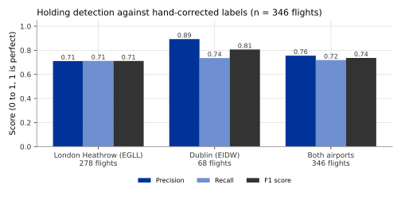
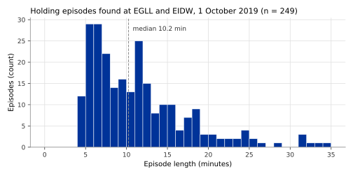

## What it is

A **holding pattern** is a loop that an aircraft flies while it waits for
permission to continue, usually before landing at a busy airport. The standard
shape is a **racetrack**: two straight legs joined by two half circles, flown
around a fixed point and at one level. One circuit takes about four to seven
minutes. A controller can also ask an aircraft to fly a single full circle, an
**orbit**, to delay it for a few minutes.

OPDI publishes each holding episode as a pair of events:

- `holding-start`: the first turning sample of the episode.
- `holding-end`: the last turning sample of the episode.

Both carry the same details in their `info` field: the sequence number of the
episode on the flight, the pattern (`racetrack` or `orbit`), the direction of
turn (`R` or `L`), the number of circuits, the duration, the distance flown,
the altitude at start and end, and the share of the episode flown straight.
Three measurements are attached to `holding-end`: `holding_duration_s` (time
in the hold, in seconds), `holding_distance_nm` (distance flown in the hold, in
nautical miles) and `holding_circuits` (total turn divided by 360 degrees).

The events carry the version `holding_v0.1.0`.

## How it is computed

A hold has a typical signature in a trajectory: the aircraft turns through at
least one nearly complete circle, **always in the same direction**, stays in a
small area, and keeps roughly one level. Other turns look different. Turns
given by a controller to space aircraft (vectoring) alternate left and right.
A go-around climbs away. A circuit flown by a light aircraft around an
aerodrome is low and slow. The rule is built to keep the first and leave out
the others.

The rule uses the cleaned position, barometric altitude, heading and ground
speed of every state vector (one every 5 seconds). The steps are:

1. **Turn per sample.** For each sample, take the change of heading since the
   last sample that had a heading, between −180 and +180 degrees. A change
   across a silence of more than 60 seconds, or faster than 6 degrees per
   second, is ignored. A sample is **turning** when it turns at 0.4 degrees
   per second or more.
2. **Window test.** Over a sliding window of 360 seconds (6 minutes), the
   window is flagged when all of these hold:
   - the signed turn (left turns negative, right turns positive) adds up to at
     least 300 degrees in either direction;
   - at least 80% of all turning is in that one direction;
   - the first and last positions of the window are at most 8 NM apart;
   - the aircraft flew at least 15 NM in the window;
   - the altitude changed by at most 2,500 ft in total (the sum of all ups and
     downs).

   The window is placed three ways, ending at the sample, starting at it and
   centred on it, so that an orbit shorter than the window is still seen
   whole. A window with a silence inside it is not judged.
3. **Height and speed.** A flagged sample counts only if the aircraft is at
   least 2,500 ft above the elevation of its airport and its ground speed is at
   least 140 kt. Aerodrome circuits, helicopters and slow training flights are
   below these limits.
4. **Episodes.** Flagged samples less than 120 seconds apart are joined into
   one episode. The episode is trimmed to its first and last turning sample.
5. **Keep or drop.** An episode is kept when it lasts at least 240 seconds and
   its signed turn adds up to at least 330 degrees. It is dropped when it
   starts or ends within 180 seconds of a `go-around` event on the same flight,
   because repeated approaches are not holds.
6. **Pattern.** An episode is an orbit when less than 15% of its samples are
   straight and its total turn is less than 450 degrees. Otherwise it is a
   racetrack.

The detection works separately on each stretch of a track between two
reception gaps (see [Track identity](track-identity.qmd)), so no episode spans
a gap. The thresholds follow the ICAO timing of holding patterns, the turn
rates airliners fly, and published rule-based holding detectors.

## Reference data

An open set of **hand-corrected holding labels** published by Olive and
colleagues. It divides two months of arrivals at four airports into 6-minute
windows, stepped by 2 minutes, and marks each window as holding or not. Every
window was checked by hand.

The rule was scored on one day of these labels, 2019-10-01, at the two
airports where OPDI has data for that day: London Heathrow (EGLL) and Dublin
(EIDW).

## Validation method

The scoring follows the method the label set's authors used for their own
detector, so that the two can be compared.

1. Run the rule on every labelled arrival of the day.
2. A labelled window counts as **detected** when at least half of it lies
   inside a detected episode.
3. Count, per flight and weighted by time:
   - **precision**: of the time the rule calls holding, the share that the
     labels also call holding;
   - **recall**: of the time the labels call holding, the share that the rule
     finds;
   - **F1 score**: a single number that balances the two (their harmonic mean).
     It is 1 when both are perfect and 0 when either is zero.

The three most important thresholds (the minimum turn, the maximum
displacement and the minimum duration) were also varied over a grid, to see
whether another setting would score clearly better.

## Results

Across both airports the rule reaches a precision of 0.76, a recall of 0.72
and an F1 score of 0.74, over 346 flights. The labels mark 1,326 of the 8,418
windows scored as holding.

| Airport | Flights | Episodes found | Precision | Recall | F1 score |
|---|---|---|---|---|---|
| London Heathrow (EGLL) | 278 | 195 | 0.71 | 0.71 | 0.71 |
| Dublin (EIDW) | 68 | 54 | 0.89 | 0.74 | 0.81 |
| Both | 346 | 249 | 0.76 | 0.72 | 0.74 |

Of the 249 episodes found, 247 are racetracks and 2 are single orbits. Their
median length is 10.2 min.

If a window counted as detected as soon as it touches an episode, the F1 score
would fall to 0.66, because episodes would be stretched at both ends.

Over the grid of 27 settings tried at each airport, the best setting improves
the F1 score by at most 0.01 over the default. The default thresholds were
therefore kept.

## Error distribution

{#fig-score-by-airport}

{#fig-duration}

@fig-score-by-airport shows that most errors are at Heathrow. There the rule
misses about as much labelled holding time as it adds unlabelled time
(precision and recall are both 0.71). At Dublin it adds little (precision
0.89) but misses about a quarter of the labelled time. @fig-duration shows
the length of the detected episodes: half of them last between 6.7 and 14.2
minutes, that is, one to a few circuits.

## Headline accuracy

F1 score 0.74 (precision 0.76, recall 0.72), measured over 346 arrivals at
London Heathrow and Dublin against hand-corrected labels.

## Limitations

- Validated on one day at two airports in Western Europe. Holding at other
  airports, and in other seasons, has not been checked.
- At Heathrow about three in ten of the minutes the rule calls holding are not
  labelled as holding, and about three in ten of the labelled minutes are
  missed.
- A hold shorter than 240 seconds, or that turns less than 330 degrees in total,
  is not reported.
- A hold flown less than 2,500 ft above the airport, or slower than 140 kt
  ground speed, is not reported.
- A loop flown within 180 seconds of a go-around is not reported, even if it
  was a hold.
- A hold that spans a reception gap is cut at the gap, or missed if too little
  of it is received.
- The rule needs heading data. Where cleaning removed headings, a hold can be
  missed.
- The `racetrack` or `orbit` label is a simple rule on straight share and total
  turn, and was not validated.

## Full study

- [Holding, point merge and FIR crossings as flight events](../../papers/airspace-events-v1/index.html),
  section 2 (the rule) and section 5 (the scoring against the labels).
