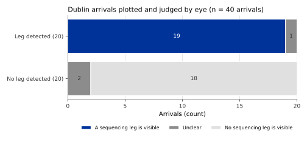

## What it is

A **point merge system** is an arrival procedure used at busy airports to put
arriving aircraft in a line. It has one **merge point**, a fixed point on the
way to the runway, and one or more **sequencing legs**: arcs flown at a nearly
constant distance from the merge point, for example 10 NM or 18 NM out. A
controller keeps an aircraft on the leg to lengthen its path, then clears it
"direct to" the merge point when there is room in the line. The time spent on
the leg is a measure of the delay absorbed before landing.

OPDI publishes three events:

- `pms-leg-entry`: the aircraft starts flying along a sequencing leg.
- `pms-leg-exit`: it leaves the leg, turning towards the merge point.
- `pms-merge-point`: the moment the aircraft passes closest to a merge point,
  when it comes within 3 NM of it, whether or not a leg was flown before.

The two leg events share the same details in `info`: the airport, the system
and merge point, the direction of flight along the arc, the leg's distance
from the merge point, its level, the time and distance on the leg, the
distance to the merge point at the exit, and whether the aircraft then flew a
straight line to the merge point. Three measurements are attached to
`pms-leg-exit`: `pms_leg_time_s` (time on the leg, in seconds),
`pms_leg_distance_nm` (distance flown along the leg, in nautical miles) and
`pms_direct_to_distance_nm` (distance to the merge point when the aircraft
left the leg).

The events carry the version `pms_v0.1.0`.

## How it is computed

The rule needs to know where each merge point is. OPDI keeps a table of point
merge systems: one row per merge point, with its coordinates, the published
distance band of its legs and the dates it has been in use. Coordinates come
from state aeronautical publications where available and otherwise from open
navigation data. Only arrivals at airports in this table are examined.

For each arrival at such an airport (the destination airport `ades` of the
flight list):

1. **Candidates.** Keep the samples within 60 NM of one of the airport's merge
   points and at or below 25,000 ft. For each, compute the distance and the
   bearing to the merge point.
2. **On a leg.** A sample is on a leg when, over a window of 90 seconds
   centred on it:
   - the distance to the merge point varies by at most 1.5 NM;
   - the mean distance lies within the leg band of the table, give or take
     2 NM;
   - the bearing from the merge point to the aircraft turns by at least 8
     degrees (the aircraft moves around the merge point, not on the spot);
   - at least 80% of the samples have a ground track 60 to 120 degrees off the
     bearing to the merge point (the aircraft moves across that bearing, not
     towards or away from it).
3. **Leg.** Consecutive samples on a leg form a leg run. A run is kept as a leg
   when it lasts at least 90 seconds, ends at least 6 NM from the merge point
   (twice the 3 NM radius below), and the aircraft then comes within 3 NM of
   the merge point within 10 minutes. Without that, the run was probably a
   turn given by a controller that happened to follow an arc, and it is not
   reported.
4. **Direct.** Whether the aircraft then flew straight to the merge point
   (ground track within 5 degrees of the bearing for at least 60 seconds,
   distance falling) is recorded in `info`, but it is not required: at some
   airports the turn towards the merge point is a curve.
5. **One leg, one merge point.** When two merge points of one system are close
   together and a leg fits both, the leg is kept once, for the merge point the
   aircraft came closest to.

The detection works separately on each stretch of a track between two
reception gaps (see [Track identity](track-identity.qmd)).

## Reference data

There is no public record of which arrivals flew a sequencing leg. Two
references were used:

- A **visual check** at Dublin (EIDW), the airport most studied in the
  literature on point merge: 20 arrivals with a detected leg and 20 without,
  chosen from 2026-06-14, plotted with the merge points and judged by eye.
- A full run of the pipeline over 2026-06-14, worldwide, to see how often legs
  are found at each airport in the table.

## Validation method

1. Plot each of the 40 Dublin arrivals on a map with the merge points and the
   arcs of the legs.
2. For each arrival with a detected leg, judge whether it shows a real
   sequencing leg: an arc at constant distance followed by a turn towards the
   merge point. For each arrival without a detected leg, judge whether it shows
   a leg that the rule missed.
3. Record "yes", "no" or "unclear" for each.

The day run is reported as a count per airport. It is not compared with a
reference, because published usage figures count aircraft that enter the
procedure, most of which are sent direct to the merge point without flying a
leg.

## Results

Of the 20 detected Dublin legs, 19 show a real sequencing leg and 1 is unclear
(a short turn that could be part of the arrival route). Of the 20 undetected
Dublin arrivals, 0 show a leg the rule missed; 2 are unclear.

On the day run, 32 of the 57 airports in the table had arrivals. Of their 6,617
arrivals, 420 flew at least one sequencing leg, with 426 legs in all.

| Airport | Arrivals | With a leg |
|---|---|---|
| Dublin (EIDW) | 418 | 52 (12.4%) |
| Lisbon (LPPT) | 334 | 74 (22.2%) |
| Oslo (ENGM) | 345 | 0 (0.0%) |

## Error distribution

{#fig-visual-check}

@fig-visual-check is a small confusion table. The rule did not report a leg
that is clearly absent, and the inspector found no leg that the rule clearly
missed. The doubtful cases are short: a leg near the minimum length of 90
seconds is hard to tell apart from a turn on the arrival route.

## Headline accuracy

Of 20 detected legs at Dublin, 95.0% show a real sequencing leg when plotted
(visual check, no undetected leg found among 20 other arrivals).

## Limitations

- Checked by eye at one airport on one day, on 40 arrivals. The precision at
  other airports is not known.
- At the Norwegian airports in the table, such as Oslo, no leg was found on the
  test day although most arrivals pass the merge point. Whether the rule misses
  them or none were flown that day is not known.
- Only airports in the merge point table are examined, and only merge points
  whose position is known. A system missing from the table gives no events.
- Merge points placed from navigation data of an earlier date than the
  procedure in use may be slightly wrong.
- A leg shorter than 90 seconds is not reported. An aircraft sent direct to the
  merge point as soon as it enters the procedure gives a `pms-merge-point`
  event but no leg.
- The share of arrivals with a leg is not the same quantity as the published
  usage of a procedure, which counts aircraft that enter it.
- The rule needs the destination airport. A flight with an empty `ades` is not
  examined.

## Full study

- [Holding, point merge and FIR crossings as flight events](../../papers/airspace-events-v1/index.html),
  section 3 (the rule) and section 6 (the day run and the visual check).
