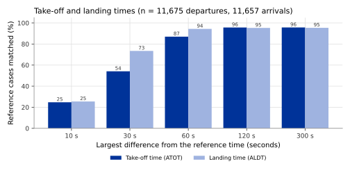

## What it is

A departure and an arrival each use a runway for a short time. OPDI publishes
four moments of that use as events:

| Event type | Moment | Standard number |
|---|---|---|
| `take-off-roll` | The aircraft starts its take-off run: it begins to accelerate along the runway. | T07 |
| `ATOT` | **Actual take-off time**: the wheels leave the runway. | T08 |
| `landing` | The aircraft passes over the **runway threshold** on its way down. The threshold is the start of the part of the runway that may be used for landing, marked on the ground by white stripes. | T16 |
| `ALDT` | **Actual landing time**: the wheels touch the runway (touchdown). | T17 |

The standard numbers come from airport collaborative decision making
(**A-CDM**), a way of working in which the airport, the airlines and air
traffic control share one set of times for each flight. OPDI writes the number
in the `info` field of the event. Note that the event `landing` is the passage
over the threshold, a few seconds before the touchdown, and not the touchdown
itself. The touchdown is `ALDT`.

Each event carries, in its `info` field, the airport (`apt_icao`), the runway
direction used (`runway`, for example `25R`) and the true bearing of that
runway's centre line (`runway_bearing_deg`, in degrees clockwise from true
north). `ATOT` and `ALDT` also carry `method`, which says which of the two
methods described below produced the time (`acdm` or `legacy`). The events
carry the version `events_v0.3.0`.

The flight list repeats the main results, so that one row holds the whole
flight:

| Column | Meaning |
|---|---|
| `atot` | Take-off time, from the flight's earliest `ATOT` event at its departure airport. |
| `aldt` | Landing time, from the flight's latest `ALDT` event at its destination airport. |
| `rwy_dep`, `rwy_dep_bearing_deg` | Runway used for take-off, and the true bearing of its centre line, from the same event as `atot`. |
| `rwy_arr`, `rwy_arr_bearing_deg` | Runway used for landing, and the true bearing of its centre line, from the same event as `aldt`. |
| `superseded_dep`, `superseded_arr` | True when the row is a piece of a departure (or arrival) that another row already counts. |
| `movement_dep`, `movement_arr` | True when the row counts as a departure (or an arrival). Use these columns to count movements. |

A column is empty when the event behind it was not found.

## How it is computed

The take-off and landing times are found by two methods. The first follows
the aircraft on the runway itself, but needs reception near the ground. The
second reads the first part of the climb and the last part of the descent,
which the receivers see far more often. The published time comes from the
first method where it gives an answer, and from the second otherwise; the
Results section compares the two.

Both methods work on the cleaned state vectors of each track (see
[Trajectory cleaning](trajectory-cleaning.qmd)), one every 5 seconds, and only
at the airports the flight list names for the flight (see
[Departure and destination airports](airports.qmd)). Runways come from
OurAirports, an open database that gives the position of both ends (the
thresholds), the length and the width of each runway. The true bearing of a
runway is computed from the positions of its two thresholds.

**Height above the airport** is used throughout. It is the barometric altitude
of the aircraft minus the elevation of the airport (the airport's height above
sea level, from OurAirports).

### The runway-pass method (`method` = `acdm`)

1. **Runway grid.** Every runway of every large and medium airport is covered
   with small hexagonal cells. These are H3 cells: H3 is an open system that
   divides the surface of the Earth into hexagons of a few fixed sizes. Here
   the size is resolution 12, where each cell covers about 300 m².
   The grid holds the runway itself and, at each end, an approach area that
   extends 1 NM out from the threshold, away from the runway.
2. **Samples on or near the runway.** A state vector is kept for a runway
   direction when its cell is in the grid and it is either on the runway
   (between the two thresholds and within half the runway width of the centre
   line) or on the approach to that direction (short of the threshold).
3. **Runway pass.** The kept samples of one runway direction, in time order,
   form a **runway pass**. A silence of more than 300 s starts a new pass.
4. **Classify the pass.** Three measurements are made over the pass: the angle
   between the runway's bearing and the median of the aircraft's direction of
   travel over the ground (its ground track), the highest
   ground speed, and the height above the airport at the first and the last
   sample that has an altitude.
   - **Departure**: angle at most 30°, ground speed above 50 kt, height below
     15 ft at the start and at least 15 ft at the end.
   - **Arrival**: angle at most 30°, ground speed above 50 kt, height at least
     15 ft at the start and below 15 ft at the end.
   - A taxiing aircraft crossing the runway is a third class, described on
     [Runway milestones](runway-milestones.qmd).
   - Anything else gives no event. In particular, an angle between 30° and 45°
     gives no event, on purpose: naming no movement is better than naming the
     wrong one.
5. **Choose the runway direction.** When several runway directions classify,
   the one whose centre line is nearest to the aircraft wins. Between the two
   directions of one runway, the one whose bearing is closest to the
   aircraft's ground track wins.
6. **`take-off-roll`.** In a departure pass, find runs of samples with ground
   speed of at least 50 kt. A run counts if it lasts at least 5 s and has no
   silence of more than 30 s inside it. The event is the first sample of the
   first such run.
7. **`ATOT`.** The moment the height above the airport rises through 15 ft.
   The time and position are interpolated in a straight line between the two
   samples on either side of 15 ft. To avoid counting a short bounce twice,
   the height must first be below 10 ft and then above 20 ft (a dead band of
   5 ft on each side).
8. **`landing`.** For an arrival pass, also take the samples up to 60 s before
   the pass. Compute the distance of each sample along the runway centre line
   from the threshold: negative before the threshold, positive after it. The
   event is the moment this distance changes sign, interpolated in the same
   way. It is kept only if the aircraft is still at least 15 ft above the
   airport at that moment.
9. **`ALDT`.** The moment the height above the airport falls through 15 ft,
   interpolated in the same way as `ATOT`.

In steps 7 to 9, a state vector without a value (an altitude emptied by
cleaning, for example) is skipped: the moment is interpolated between the
last state vector with a known value and the next one. When those two are
more than 30 minutes apart, no event is given, because its time and position
cannot be placed.

These events carry a position, an altitude and the measurements distance flown
and time passed (see [Measurements](measurements.qmd)), all interpolated to
the same moment.

### The climb-and-descent method (`method` = `legacy`)

This method follows the runway detection of the open-source
[`traffic`](https://traffic-viz.github.io/) library, a Python library for
working with aircraft trajectories. It is applied to the departure airport and to the
destination airport of the flight list.

1. Keep the samples of the track that are within 5 NM of the airport's
   reference point (the single position that officially marks where the
   airport is), less than 1,500 ft above the airport, faster than 30 kt
   ground speed, and climbing faster than 257 ft/min (departure) or descending
   faster than 257 ft/min (arrival).
2. At least 4 samples must remain. They are the initial climb or the final
   descent.
3. **Runway.** Take the median ground track of these samples. The candidate runways
   are those whose bearing is within 10° of it. Among them, the one whose
   centre line is nearest to the median position wins; the bearing breaks a
   tie.
4. **Time.** For a departure, the time of the earliest remaining sample. For
   an arrival, the time of the latest remaining sample.

These events carry no position, no altitude and no measurements: those fields
are empty.

### One take-off and one landing per track

Each track keeps at most one `ATOT` and one `ALDT` event. If the runway-pass
method found the moment, its value is kept (the earliest, if it found
several); otherwise the value of the climb-and-descent method is kept. The
field `method` in `info` says which.

The [plausibility checks](plausibility-checks.qmd) then leave out an `ATOT`
or `ALDT` that is more than 1,500 ft above its airport, measured by the
event's own altitude or, for the climb-and-descent method, by the altitude of
the nearest state vector within 60 s. `landing` is not checked against the
height.

The flight list then takes `atot` from the earliest `ATOT` at the departure
airport and `aldt` from the latest `ALDT` at the destination airport, with
the runway and bearing of the same event. A runway event also corrects the
flight list's departure or destination airport when the two disagree: the
airport where the aircraft was seen on the runway wins (see
[Departure and destination airports](airports.qmd)).

### Counting departures and arrivals

A departure is often cut into two tracks: a short piece on the ground, at the
stand, then the flight itself. Both pieces start at the airport, so both would
count as a departure. The quality columns of the flight list mark the extra
pieces:

1. `superseded_dep` is true when the row has no take-off time (`atot` empty)
   and the same aircraft departs again from the same airport within 3 hours
   (10,800 s) after this row's first position. `superseded_arr` is the mirror
   for arrivals: no landing time, and the same aircraft arrived at the same
   airport within the 3 hours before.
2. A row is also not counted as a departure when it has no take-off time, no
   destination airport and no crossing of any distance ring around its
   departure airport (see [Distance rings](distance-rings.qmd)). Such a row
   shows an aircraft near an airport, not a flight. The mirror rule applies to
   arrivals.
3. `movement_dep` is true when the row has a departure airport and neither
   rule above applies. `movement_arr` is the same for arrivals.

These rules are applied only to days whose events have been computed.

## Reference data

**Airport operator records** (the airport data flow, APDF). Airports send
EUROCONTROL a record of each departure and arrival. For each movement the
record gives the actual off-block, take-off, landing and in-block times, the
runway and the stand. These records do not contain the aircraft address. They
are linked to the flight records of the EUROCONTROL Network Manager, which do
contain it. The Network Manager is the EUROCONTROL service that coordinates air
traffic across Europe and holds the flight plan of every flight it handles. The
linked records are then matched to OPDI flights by aircraft address, call sign
and day.

The study used three days, 5 to 7 June 2026, at the 20 airports with the best
ADS-B reception in the OPDI data on those days: EBBR, LSZH, EICK, EFHK, LEIB,
EDDS, LFLL, LHBP, LFPO, LPFR, ESSA, ENVA, LOWW, LKPR, EDDP, LPPT, EGGD, EGNT,
EGCC and UGKO.

At most of these airports the reference times are given to the whole minute.
Only at Zurich (LSZH), Ibiza (LEIB) and Stuttgart (EDDS) are they given to the
second. Against a time rounded to the minute, a perfect detector would still
show differences of up to a minute.

## Validation method

1. For each reference departure, find the OPDI flight with the same aircraft
   address and call sign on the same day, and take its `ATOT` events. If
   there are several, the one nearest in time to the reference is used.
   Arrivals are treated in the same way with `ALDT`.
2. Compute the difference: OPDI time minus reference time. A positive value
   means OPDI is late.
3. Over all reference movements, report:
   - **coverage**: the share of reference movements for which OPDI has an
     event;
   - the **median difference**, which shows a systematic shift;
   - the **median absolute difference** and the **90th percentile** of the
     absolute difference, which show the spread;
   - the share of reference movements with an OPDI time within 10 s, 30 s,
     60 s, 120 s and 300 s. These shares are counted over all reference
     movements, so a movement without an OPDI event counts as a miss.
4. Score each method on its own, and the two ways of combining them: the
   runway-pass method first (as published) and the climb-and-descent method
   first.
5. Compare the runway named by the runway-pass method with the runway in the
   reference, written the same way (for example `07R` against `07R`).

## Results

The study covers 20 airports, 11,675 reference departures and 11,657
reference arrivals.

| | Take-off time (`ATOT`) | Landing time (`ALDT`) |
|---|---:|---:|
| Coverage | 96.22% | 95.96% |
| Median difference | +25.0 s | −2.4 s |
| Median absolute difference | 25.3 s | 18.2 s |
| 90th percentile of absolute difference | 60.0 s | 41.4 s |
| Within 10 s | 24.71% | 25.48% |
| Within 30 s | 54.10% | 73.43% |
| Within 60 s | 86.97% | 94.36% |
| Within 120 s | 95.69% | 95.26% |
| Within 300 s | 95.72% | 95.37% |

**Each method on its own.** The climb-and-descent method answers more
movements; the runway-pass method needs the aircraft to be received near the
ground.

| | Coverage | Median difference | Median absolute difference | Within 60 s |
|---|---:|---:|---:|---:|
| `ATOT`, runway-pass method | 76.58% | +21.9 s | 22.3 s | 69.94% |
| `ATOT`, climb-and-descent method | 89.78% | +25.0 s | 25.0 s | 83.14% |
| `ALDT`, runway-pass method | 80.37% | −6.1 s | 18.1 s | 79.21% |
| `ALDT`, climb-and-descent method | 95.92% | +5.0 s | 15.0 s | 94.58% |

**Airports with times to the second.** At the 3 airports whose reference times
are given to the second, the median difference shows each method's own shift.
In the table, "runway pass" is the runway-pass method and "climb" and
"descent" the climb-and-descent method:

| Airport | `ATOT`, runway pass | `ATOT`, climb | `ALDT`, runway pass | `ALDT`, descent |
|---|---:|---:|---:|---:|
| Zurich (LSZH) | +7.2 s | +4.0 s | −17.1 s | −5.0 s |
| Ibiza (LEIB) | −1.5 s | −6.0 s | −19.4 s | −7.0 s |
| Stuttgart (EDDS) | +6.4 s | +1.0 s | −25.6 s | −13.0 s |

For the landing time, the median difference of the runway-pass method lies
between −17.1 s and −25.6 s at these airports, and that of the
climb-and-descent method between −5.0 s and −13.0 s: the runway-pass method
places the touchdown earlier than the airports do.

**Order of the two methods.** The study also scored the other order, with the
climb-and-descent value taken first. It gives nearly the same coverage (96.25%
of departures, 95.96% of arrivals) and more times within 10 s: 30.92% of
departures and 41.07% of arrivals, against 24.71% and 25.48% for the published
order.

**Runway.** The runway-pass method names a take-off runway for 76.61% of
reference departures; 86.05% of these 8,944 runways are the runway in the
airport record. It names a landing runway for 80.37% of reference arrivals; 92.56% of
these 9,369 runways are right. The runways named by the climb-and-descent
method were not compared.

`take-off-roll` and `landing` are not validated: the airport records hold no
time for the start of the take-off run or for the passage over the threshold.
The quality columns `superseded_dep`, `superseded_arr`, `movement_dep` and
`movement_arr` are not validated either.

## Error distribution

{#fig-within}

@fig-within shows that most of the remaining difference is under a minute.
Part of it comes from the rounding of most reference times to the minute.
Beyond 120 s the bars hardly grow: a published time is either close to the
record or missing.

## Headline accuracy

`ATOT`: 86.97% of 11,675 reference departures at 20 airports have a published
take-off time within 60 s of the airport's record. `ALDT`: 94.36% of 11,657
reference arrivals have a landing time within 60 s. Of the runways named by
the runway-pass method, 86.05% of take-off runways and 92.56% of landing
runways match the airport record.

## Limitations

- The study airports are the 20 with the best reception. Elsewhere, coverage
  is lower, and more of the times come from the climb-and-descent method.
- Most reference times are rounded to the minute, so differences of less than
  about 30 s cannot be judged except at Zurich, Ibiza and Stuttgart.
- The published times mix two methods with different shifts. The runway-pass
  method's landing time tends to be earlier than the airports' records, by
  about 17 to 26 s at the three airports with times to the second. Use the `method` field
  in `info` to separate the two when this matters, for example when comparing
  airports.
- Where both methods found a time, only the runway-pass value is published.
  Taking the climb-and-descent value first would have put more times within
  10 s of the records.
- The climb-and-descent method's events have no position, no altitude and no distance or time
  measurements.
- A track keeps at most one `ATOT` and one `ALDT`. If a track holds two flights
  (for example a turnaround without a change of call sign), the second
  take-off or landing is lost.
- The events can only be found at airports that the flight list names for the
  flight, and that have runways in OurAirports. The runway-pass method needs the aircraft to
  be received within a few feet of the runway; many airports have no
  receiver close enough.
- The height above the airport uses the uncorrected barometric altitude. On a
  day with high or low air pressure, the 15 ft crossing moves slightly.
- On a runway whose bearing is close to the north–south line (runways
  numbered 18 and 36), the median ground track can come out pointing the wrong way. The runway direction
  can then be wrong, and `landing` can be missing although `ALDT` is present.
- If an aircraft is first received when already faster than 50 kt,
  `take-off-roll` is placed at the first sample received, which is too late.
  Nothing in the data marks this case.
- `landing` needs a sample less than 60 s before the aircraft enters the
  runway area. It is missing more often than `ALDT`.
- The runway named by the climb-and-descent method has not been checked
  against the records.
- The rules that mark `superseded_*` and `movement_*` have not been checked
  against reference counts.
- The study's tracks were built with a track rule that starts a new track at
  every long reception gap (see [Track identity](track-identity.qmd)). The
  runway methods are the same as in this release, and near airports such gaps
  are rare.

## Full study

- [Flight events from ADS-B](../../papers/flight-events-v4/index.html),
  chapters "Timing a runway movement", "Take-off roll", "Airborne", "Landing",
  "Touchdown" and Annex A (accuracy by airport).
