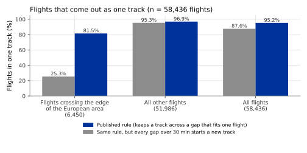

## What it is

OPDI builds every flight from **ADS-B** position reports. ADS-B (Automatic
Dependent Surveillance–Broadcast) is a radio message that an aircraft sends
about once per second. It carries the aircraft's position, altitude, speed and
identity. The OpenSky Network collects these messages with ground receivers and
stores them as **state vectors**: one row per aircraft and second, with the
latest position, altitude, speed and heading heard.

Two fields of a state vector identify the aircraft:

- The **ICAO 24-bit address** (`icao24`) is a code of six hexadecimal
  characters, for example `4ca7b5`, that is set in the aircraft's transponder.
  It normally stays with one airframe for years.
- The **call sign** (`flt_id`) is the flight's radio name, for example
  `DLH123`. It changes from one flight to the next and is sometimes blank or
  received wrongly.

Neither field says where one flight ends and the next begins. A **track** is
OPDI's answer: the run of state vectors of one aircraft that OPDI treats as one
flight. Each track gets an identifier, published as `flight_id` in the flight
list and in the flight events file. One row of the flight list is one track.

Getting the track right matters for everything built on it. A flight cut in
two pieces gives two rows in the flight list, each with only one airport. Two
flights glued into one track lose the landing and take-off between them.

## How it is computed

The rule works on the state vectors of one aircraft at a time, sorted by time,
after they have been thinned to one per 5 seconds (see
[Processing steps](pipeline.qmd)). It reads each state vector in turn and
decides whether a new track starts there.

1. **Group by aircraft.** All state vectors with the same ICAO 24-bit address
   are considered together. The call sign is not part of the grouping, so a
   blank call sign does not start a track of its own.
2. **Start a new track when the call sign really changes.** Blank call signs
   are skipped. A new call sign starts a new track only if it stays the same
   for at least 30 seconds before the next change. A call sign that flickers to
   a garbled value and back therefore does not split the flight. The new call
   sign is compared with the last one heard in the previous 30 minutes.
3. **Start a new track after a short silence at low altitude.** If no state
   vector arrives for more than 15 minutes and the aircraft is below 5,000 ft
   when it is heard again, a new track starts. This catches an aircraft that
   landed and took off again while out of reception.
4. **After a long silence, start a new track unless both sides fit one flight.**
   A silence of more than 30 minutes is called a **gap**. The samples just
   before and just after the gap are its two **edges**. The gap stays inside
   one track only if every check in the table below passes. If a value a check
   needs is missing, the check fails and a new track starts, unless the table
   says otherwise.

| Check | Setting | Why |
|---|---|---|
| Gap not too long | at most 600 minutes (10 hours) | A longer silence leaves room for anything to have happened. |
| En route before the gap | The lowest of the 5 nearest altitudes within 5 minutes before the gap is at or above 18,000 ft. If it is lower, the aircraft must be climbing faster than 500 ft/min on average over at least 3 vertical-rate values. | An aircraft lost at cruise, or still climbing out, is on its way somewhere. |
| En route after the gap | The same altitude rule at the other edge: at or above 18,000 ft. If it is between 5,000 ft and 18,000 ft, the aircraft must be descending faster than 500 ft/min on at least 3 vertical-rate values. | An aircraft that reappears on its descent is arriving. |
| No descent then climb | not both descending faster than 500 ft/min before and climbing faster than 500 ft/min after; a missing vertical rate does not count against it | That is what a stop inside the gap looks like. |
| Call sign agrees | the last call sign before the gap (at most 60 minutes old) and the first after it (within 10 minutes) are not both present and different; a blank agrees with anything | A different call sign is a different flight. |
| Straight-line speed not too slow | at least 400 kt: the great-circle distance between the edge positions divided by the time between them | A stop uses up time, which lowers this speed. |
| Straight-line speed not impossible | at most 750 kt | Faster than this means two aircraft share one address. |
| Real address | the ICAO address is not `000000`, `000001` or `ffffff` | These placeholder values are used by many aircraft. |

The edge values are read past blank samples, within 5 minutes of the gap,
because ADS-B sends position and altitude in separate messages and the sample
right at an edge often lacks one of them.

5. **Name the track.** The identifier is the first 16 characters of the
   SHA-256 hash of the ICAO address, an underscore, and the time of the track's
   first state vector in seconds since 1970-01-01 (Unix time), for example
   `3f9a0c1d2b4e5f60_1781412334`.

A gap kept inside a track stays empty: no position is invented. The event
detectors that compare neighbouring samples, such as level segments and
flight-level crossings, work separately on each stretch between two gaps, so
nothing is computed across a gap. The cumulative distance adds the straight
line between the two edges (see [Measurements](measurements.qmd)).

A day's run reads 11 hours of the previous day, so that a gap close to midnight
is decided the same way on both days. A track belongs to the day of its first
state vector, which is its date of flight (`dof`).

## Reference data

EUROCONTROL **Network Manager** flight data for 2025-06-14 and 2026-06-14. The
Network Manager is the EUROCONTROL function that manages air traffic flows in
Europe; its records hold, for each flight in or through the European area, the
aircraft address, the call sign and the take-off and landing times. They cover
Europe only, so a flight's events outside Europe are not in them.

Reference flights are matched to tracks on the aircraft address and the time
of flight. The call sign is not used for matching, because the rule itself
uses it.

## Validation method

Four tests were run on the two days.

1. **One flight, one track.** For each reference flight, count the tracks that
   hold its state vectors. The flight is "in one track" when exactly one track
   holds it. Flights that cross the edge of the European area, to or from
   another continent, are counted separately, because they are the ones that
   lose reception over the ocean.
2. **Real gaps.** Each gap that the rule kept inside a track is checked against
   the reference. If a landing or take-off of that aircraft falls inside the
   gap, the gap is a **false join**: two flights glued into one track. If the
   gap lies inside one reference flight, it is a true link. Otherwise it cannot
   be checked.
3. **Hidden landings.** Take two consecutive flights of one aircraft and delete
   the state vectors from a cruise point of the first to a cruise point of the
   second, so that a real landing sits inside an artificial gap. The rule
   should not join them.
4. **Cut flights.** Delete 60 to 360 minutes from the middle of one continuous
   flight. The rule should join the two pieces again.

A false join is treated as the worse mistake. A split leaves two truthful
pieces; a false join removes a landing and a take-off from the data and pairs
an airport of one flight with an airport of the other. The study also ran the
same data with a rule that starts a new track at every gap of more than 30
minutes, to show what keeping gaps adds.

## Results

Over the two days, 95.2% of the 58,436 reference flights come out as exactly
one track (1.02 tracks per flight). With every gap over 30 min starting a new
track, the share would be 87.6%.

| Flights | Number | In one track | Every gap over 30 min starts a new track |
|---|---|---|---|
| Crossing the edge of the European area | 6,450 | 81.5% | 25.3% |
| All other flights | 51,986 | 96.9% | — |
| All flights | 58,436 | 95.2% | 87.6% |

The count includes 931 reference flights that have no track at all; they are
counted as not in one track.

| Test | Result |
|---|---|
| Gaps in the real data (not the made-up gaps of the tests "Hidden landings" and "Cut flights") kept inside a track | 24,422 of 228,655 gaps of more than 30 min |
| Kept gaps that the reference can check | 5,888 |
| False joins among them | 1 (0.017%) |
| Kept gaps the reference cannot check | 75.9% |
| Hidden landings wrongly joined | 6 of 234,444 (upper 95% confidence bound 0.0051%) |
| Cut flights joined again | 81.0% of 49,518 |

## Error distribution

{#fig-one-track}

@fig-one-track shows where the remaining errors are. Almost all flights inside
Europe come out as one track. Flights to and from other continents are split
more often, because they lose reception over the ocean for hours and some of
them reappear too low or too slowly for the checks to accept the gap.

## Headline accuracy

95.2% of 58,436 reference flights come out as exactly one track. Among 5,888
gaps that the rule kept inside a track and that the reference can check, 1 is a
false join.

## Limitations

- A track can contain gaps of up to 10 hours with no data. Do not interpolate
  positions, altitudes or times across a silence of more than 30 minutes.
- About three quarters of the kept gaps (75.9%) lie outside Europe and could
  not be checked. The false-join rate is measured on the rest.
- A flight can still be split in several tracks: when the call sign changes in
  flight, after a silence of more than 15 minutes below 5,000 ft, or when a gap
  fails a check. About one cut flight in five stayed split in the test.
- Two flights of one aircraft can be joined when the aircraft lands and takes
  off again during a long silence and keeps the same or a blank call sign. The
  test found this rare, but not impossible.
- Tracks are built from ADS-B reports only. ADS-C position reports, which
  aircraft send by satellite link, mainly over the oceans, are not used in
  release v2.0.0; see
  [Does ADS-C improve the OPDI results?](../../papers/adsc-effect-v1/index.html).
- A track starts where reception starts. It is not a flight plan: a track can
  begin in the air or end before landing.
- `flight_id` depends on the rule that built it. Identifiers from different
  releases cannot be joined. The track rule is not named in the data; the
  flight list `version` changes with it.
- Aircraft that share a placeholder address (`000000`, `000001`, `ffffff`) are
  never joined across a gap.
- The reference covers two days, both in June.

## Full study

- [One flight, one track across a reception gap](../../papers/track-construction-v5/index.html):
  the rule, the four tests, the full results and a full run of the pipeline on
  one day.
