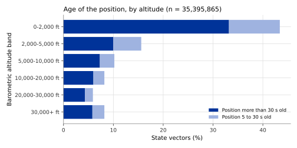

## What it is

The position reports that OPDI receives contain errors. Some values are
repeated rather than measured again, some jump to an impossible value for one
or two seconds, and some stand alone with no other report nearby. Trajectory
cleaning finds such values and **empties** them: the value becomes missing
(NULL), but the row is kept. The other values of the row stay as they were.

Cleaning concerns seven fields of each state vector (one row per aircraft and
time, see [Track identity](track-identity.qmd#what-it-is)): latitude,
longitude, barometric altitude (the altitude from the aircraft's air pressure
sensor), geometric altitude (from satellite navigation), ground speed, heading
and vertical rate. It never changes the identity fields (ICAO address, call
sign, time).

Emptying a value, rather than replacing it by an estimate, keeps a clear
difference between "no data" and "estimated data". Cleaned state vectors are
not published themselves. Every flight list column and event is computed from
them.

The method follows the cleaning of the winning solution of the 2024 PRC Data
Challenge (Alligier and Gianazza, ENAC), the best published evidence on
cleaning OpenSky data.

## How it is computed

Before cleaning, when the data are read from the OpenSky Network, each
aircraft's state vectors are **thinned** to one per 5 seconds: in each 5-second
window the newest state vector is kept.

Cleaning then runs six stages on each track, in this order.

1. **Duplicates.** Two rows of one track with the same time: one is kept, the
   one most recently received.
2. **Impossible coordinates.** A latitude outside −90 to 90 degrees or a
   longitude outside −180 to 180 degrees is emptied.
3. **Repeated values.** ADS-B sends position and speed in separate messages,
   and the OpenSky Network repeats the last value heard until a new one
   arrives. A value equal to the one before was therefore often not measured
   again. Three rules apply:
   - Latitude and longitude are emptied when the position was not measured
     again. A state vector records when its position was last updated; the
     position counts as new when that time has moved on, even if the aircraft
     did not move (a parked aircraft). Where that time is missing, the position
     counts as new when latitude or longitude changed.
   - The barometric altitude is emptied when neither the position was measured
     again nor the altitude changed.
   - Ground speed, heading and vertical rate are all emptied when none of the
     three changed.

   The first row of a track is never treated as a repeat.
4. **Spikes.** For each field, the rate of change between two consecutive
   values that are still present is compared with a limit (first derivative).
   So is the change of that rate (second derivative). A value is emptied when it
   takes part in at least two over-limit changes of the same kind. The middle
   of a spike takes part in both the jump up and the jump down; a real step
   change takes part in only one and is kept. The limits are:

| Field | Limit on rate of change | Limit on change of rate |
|---|---|---|
| Barometric altitude | 200 ft/s | 50 ft/s |
| Geometric altitude | 200 ft/s | 150 ft/s |
| Vertical rate | 1,500 ft/min per second | 1,000 ft/min per second |
| Ground speed | 12 kt/s | 10 kt/s |
| Heading | 12 degrees/s | 10 degrees/s |
| Latitude and longitude | 0.01 degrees/s | 0.06 degrees/s |

5. **Isolated values.** A value with no other present value of the same field
   within 20 seconds on either side cannot be confirmed and is emptied.
6. **Silences.** A silence of 300 seconds or more marks the start of a new
   segment of the track, so that later steps never interpolate across it.

Separately, when tracks are built, a barometric or geometric altitude that
changes faster than 200 ft/s from the previous sample is emptied in the
altitude column that the event detectors read.

Three things are deliberately **not** done, because the PRC Data Challenges
found that they made results worse: filling gaps with invented positions,
removing positions disturbed by satellite-navigation jamming, and correcting
speeds with weather-model wind.

## Reference data

There is no reference for the true position of each aircraft every 5 seconds,
so cleaning cannot be checked value by value. Two indirect references were
used:

- EUROCONTROL **Network Manager** movement data (the take-off and landing
  airports of each flight in the European area) for 2025-06-05 to 2025-06-07
  and 2024-06-05 to 2024-06-07, to see whether cleaning changes how often the
  destination airport is named correctly.
- Three hours of the raw OpenSky archive, 2025-06-05 06:00 to 09:00 UTC in the
  European area, to measure how old the positions are and how much the
  thinning keeps.

## Validation method

Not validated directly against true positions. Two indirect checks were made.

1. **Effect on destination airports.** The detection of the destination airport
   (see [Departure and destination airports](airports.qmd)) was run twice on
   the same flights, once on cleaned and once on uncleaned tracks, with
   everything else equal. Both runs were scored against the Network Manager
   data: the share of reference flights given an airport, and the share of
   named airports that are wrong.
2. **Age of positions and thinning.** On the raw archive, the age of each
   position (the time since it was last measured) was measured by altitude.
   The thinning was compared with the simpler rule of keeping only the seconds
   divisible by 5.

## Results

| Sample | Wrong destination airports, without cleaning | With cleaning | Arrivals given an airport, without cleaning | With cleaning |
|---|---|---|---|---|
| June 2025 (95,116 flights) | 1,172 (1.8%) | 923 (1.4%) | 69.1% | 68.3% |
| June 2024 (92,799 flights) | 1,659 (2.8%) | 1,579 (2.7%) | 62.7% | 62.1% |

Cleaning removes about one wrong destination airport in five in the 2025
sample, and a smaller share in 2024. In exchange, slightly fewer arrivals get
an airport, because each emptied altitude is one sample fewer for the
detection.

Positions are often old. Below 2,000 ft, 33.2% of state vectors carry a
position more than 30 s old. In the highest band, 30,000+ ft, the share is
5.8%.

The 5-second thinning used today keeps 1.002 times as many rows as keeping only
the seconds divisible by 5 (over 39,139,623 state vectors), because the
OpenSky archive has a row for nearly every second.

## Error distribution

{#fig-position-age}

@fig-position-age shows why the repeated-value stage matters most near the
ground. Close to airports, reception is patchy, and many state vectors repeat a
position heard tens of seconds earlier. At cruise altitude, most positions are
fresh. The study data hold no distribution of the errors of individual cleaned
values, because there is no reference for them.

## Headline accuracy

Not validated directly. In the indirect check, cleaning lowers the share of
wrongly named destination airports from 1.8% to 1.4% (95,116 reference flights,
June 2025).

## Limitations

- Cleaning empties values; it does not repair them. Many positions,
  altitudes and speeds in the cleaned tracks are missing, and the event
  detectors then have fewer samples to work with.
- Events tied to small areas on the airport surface, such as runway
  thresholds, are the most sensitive to emptied ground positions.
- Cleaning slightly lowers the share of arrivals that get a destination
  airport.
- The departure airport did not change in the check, because the departure
  method read cleaned positions in both runs. The check measures the effect on
  arrivals only.
- The limits come from the 2024 PRC Data Challenge solution and were not tuned
  on OPDI data.
- Jamming of satellite navigation is not removed. Positions affected by it stay
  in the data unless they break one of the limits above.
- The age measurement covers three morning hours of one day in the European
  area.

## Full study

- [Thinning state vectors, and what the archive actually contains](../../papers/statevector-decimation/index.html):
  the thinning rule and the age of positions.
- [Departure and destination aerodromes in the OPDI flight list](../../papers/adep-ades-detection-v7/index.html#sec-cleaning):
  what cleaning costs and buys for airport detection.
- [Flight events from ADS-B](../../papers/flight-events-v4/index.html):
  the effect of cleaning on airport surface events.
